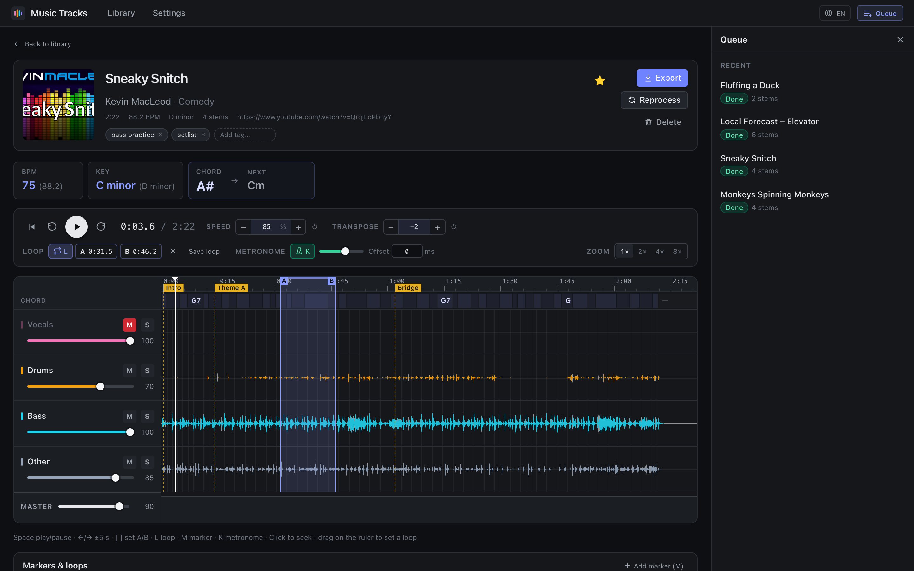
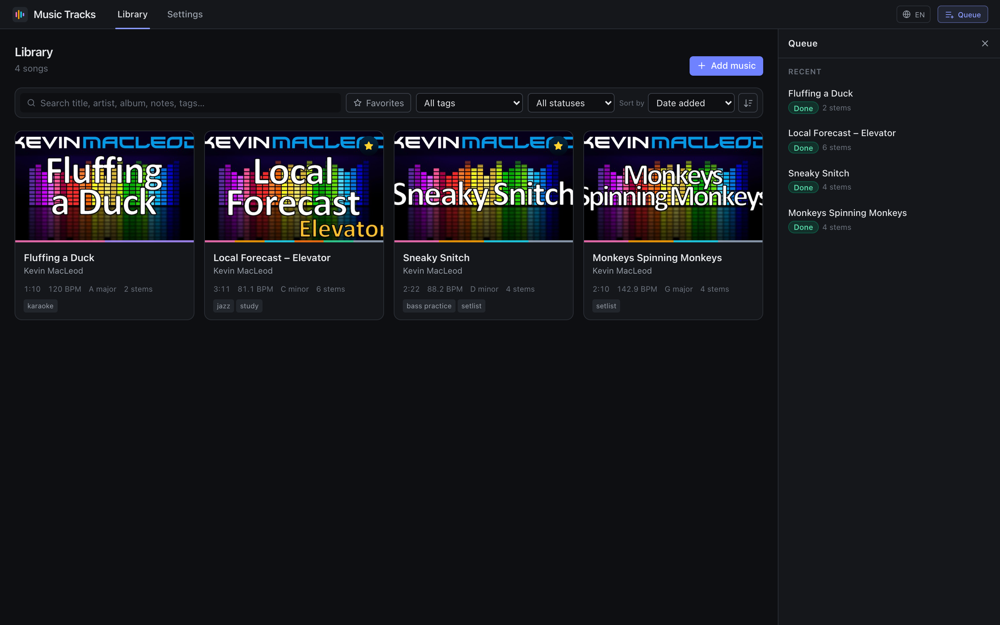
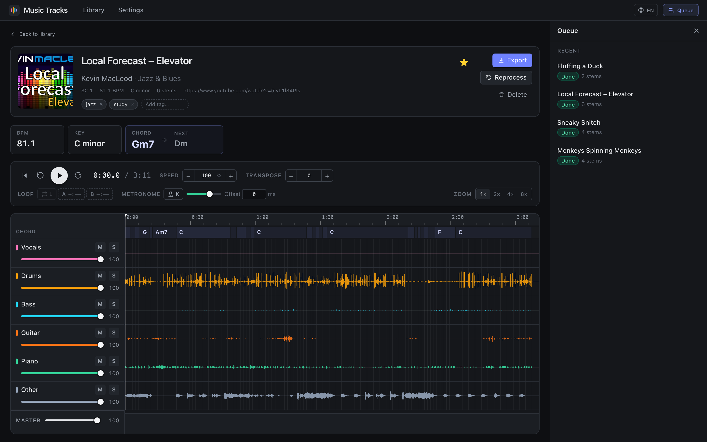

<div align="center">

# 🎚️ Music Tracks

**Split any song into stems and practice with them — locally, privately, for free.**

Separate vocals, drums, bass, guitar and piano with state-of-the-art AI, then slow the song down without changing its pitch, transpose it, loop the hard part, mute your instrument and play along with a metronome that follows the beat.

[](https://github.com/edumelocarv/music-tracks/actions/workflows/ci.yml)
[](LICENSE)


**English** · [Português (Brasil)](README.pt-BR.md)



</div>

---

## Why?

Practicing with recordings is the fastest way to learn a song — but you usually want to *hear the bass alone*, *remove the vocals to sing*, or *play the solo at 70% speed*. Online stem-splitters upload your music, have queues and paywalls, and give you a file, not a practice tool.

**Music Tracks runs entirely on your computer.** You add songs, it separates them on your GPU, and you get a practice-focused player in the browser.

## Features

**🎛️ Stem separation**
- **2, 4 or 6 stems per song** — vocals/instrumental · vocals/drums/bass/other · + guitar and piano.
- Powered by **[Demucs](https://github.com/adefossez/demucs)** (`htdemucs_ft` and `htdemucs_6s`), one of the best open-source separation models.
- Runs on **Apple Silicon GPUs (MPS)**, **NVIDIA GPUs (CUDA)** or the CPU — picked automatically.

**🎧 Practice player**
- Per-stem **volume, mute and solo**, plus master volume.
- **Speed 50–150% without changing pitch** and **transpose ±12 semitones without changing speed** — in real time, perfectly in sync across stems ([Signalsmith Stretch](https://signalsmith-audio.co.uk/code/stretch/)).
- **A-B loop**, saved loops and **markers**.
- **Metronome** locked to the detected beats (with downbeat accent) that follows the speed you choose.
- **Waveforms** per stem with zoom, and a **chord lane** showing the current and next chord.

**🎼 Analysis**
- **BPM**, beats and downbeats ([beat_this](https://github.com/CPJKU/beat_this)).
- **Key** and **chords** (major, minor, 7ths) — automatically **transposed** when you shift the pitch.

**📚 Library**
- Add music by **file upload**, **URL** (YouTube and [many other sites](https://github.com/yt-dlp/yt-dlp/blob/master/supportedsites.md)) or a **watch folder**.
- Processing **queue** with live progress, cancel and retry.
- Search, sort, **tags**, **favorites**, **notes**, editable metadata and cover art.

**📦 Export**
- Individual stems, a **ZIP with all stems**, or a **custom mix** (your current volumes/mutes, optionally with speed and pitch applied) as **WAV, FLAC or MP3**.

**🌍 Interface in English and Portuguese (Brazil).**

<table>
<tr>
<td></td>
<td></td>
</tr>
<tr>
<td align="center"><sub>Library and processing queue</sub></td>
<td align="center"><sub>6-stem mode (guitar and piano)</sub></td>
</tr>
</table>

## Quick start

You need **[uv](https://docs.astral.sh/uv/)** (installs Python for you), **[Node.js](https://nodejs.org/) 20+** (builds the web interface on first run) and **[FFmpeg](https://ffmpeg.org/)**.

### macOS (Apple Silicon)

```sh
brew install uv node ffmpeg
git clone https://github.com/edumelocarv/music-tracks.git
cd music-tracks
./start.sh
```

### Windows 10/11

```powershell
winget install astral-sh.uv OpenJS.NodeJS.LTS Gyan.FFmpeg
# open a NEW terminal so the PATH is updated, then:
git clone https://github.com/edumelocarv/music-tracks.git
cd music-tracks
start.cmd
```

> Prefer PowerShell? Use `.\start.ps1` (if scripts are blocked: `powershell -ExecutionPolicy Bypass -File .\start.ps1`).

### Linux (Debian/Ubuntu)

```sh
sudo apt install ffmpeg nodejs npm          # Node.js must be 20+ (use NodeSource or nvm if your distro is older)
curl -LsSf https://astral.sh/uv/install.sh | sh
git clone https://github.com/edumelocarv/music-tracks.git
cd music-tracks
./start.sh
```

Fedora: `sudo dnf install ffmpeg nodejs uv` (FFmpeg from RPM Fusion). Arch: `sudo pacman -S ffmpeg nodejs npm uv`.

### Docker

```sh
docker compose up -d --build
```

Then open **http://127.0.0.1:8765**. For an NVIDIA GPU on Linux, install the [NVIDIA Container Toolkit](https://docs.nvidia.com/datacenter/cloud-native/container-toolkit/) and uncomment the `deploy:` section in [`docker-compose.yml`](docker-compose.yml). Docker on macOS cannot use the Apple GPU — on a Mac, the native install is much faster.

---

The first run installs the dependencies and builds the interface (a few minutes), then opens **http://127.0.0.1:8765** in your browser. Stop it with **Ctrl+C**.

The **first separation downloads the AI models** (~320 MB per model, once). After that everything works offline, except adding songs by URL.

## Which GPU will it use?

| Your computer | Native install | Docker |
|---|---|---|
| Mac with Apple Silicon (M1–M4) | ✅ Apple GPU (MPS) | CPU only |
| Windows + NVIDIA GPU | ✅ CUDA | ✅ CUDA (WSL 2) |
| Linux + NVIDIA GPU | ✅ CUDA | ✅ CUDA (Container Toolkit) |
| AMD / Intel GPU, or no GPU | CPU | CPU |

The device in use is shown in **Settings → System**. CPU works everywhere, it is just slower (a few minutes per song instead of about a minute). NVIDIA support uses CUDA 12.6 builds of PyTorch, which work with drivers from the last few years.

**Typical separation time** for a 4-minute song on an Apple M4: about **1 minute** in 2- or 4-stem mode and about **30 seconds** in 6-stem mode, plus a few seconds of analysis.

## Using it

### Adding music

- **Upload** — click **Add music** and drag files in (MP3, WAV, FLAC, M4A, AAC, OGG, Opus, AIFF, WMA, or video files such as MP4/MKV/WebM). Up to 500 MB and 15 minutes per song.
- **URL** — paste a link from YouTube or another site supported by yt-dlp. Playlists and live streams are not accepted.
- **Watch folder** — drop files into `~/MusicTracks/inbox/` (Windows: `%USERPROFILE%\MusicTracks\inbox\`). They are imported automatically with your default stem mode. Rejected files go to `inbox/_ignorados/` with a `.erro.txt` explaining why.

Each song is processed in the queue (download → prepare → separate → analyze → waveforms). You can keep using the app meanwhile.

### Stem modes

| Mode | Stems | Model | Notes |
|---|---|---|---|
| **2** | vocals, instrumental | `htdemucs_ft` | Karaoke and a cappella |
| **4** | vocals, drums, bass, other | `htdemucs_ft` | Best quality — **the default** |
| **6** | vocals, drums, bass, guitar, piano, other | `htdemucs_6s` | Guitar is decent; **piano is weak** (often bleeds into "other") |

You can **reprocess** a song in another mode at any time. The current stems stay playable until the new ones are ready.

### Keyboard shortcuts

| Key | Action |
|---|---|
| `Space` | Play / pause |
| `←` / `→` | Seek −5 s / +5 s |
| `[` / `]` | Set loop start (A) / end (B) at the playhead |
| `L` | Toggle the A-B loop |
| `M` | Add a marker |
| `K` | Toggle the metronome |

You can also click a waveform to seek and **drag on the ruler** to create a loop. Your mixer settings, speed, pitch, loop and metronome are saved per song.

### Exporting

Click **Export** on a song to download a stem, a ZIP with every stem, or a **custom mix** of what you are hearing right now (for example a backing track without your instrument). For the mix you can optionally apply the current speed and pitch, or export only the A-B section.

## Configuration

Everything (library database, audio, models, logs) lives in one data folder, **`~/MusicTracks`** by default. You can change it in **Settings** (takes effect after a restart; existing data is not moved) or with environment variables:

| Variable | Default | Purpose |
|---|---|---|
| `MUSIC_TRACKS_HOME` | `~/MusicTracks` | Data folder (overrides the Settings value) |
| `MUSIC_TRACKS_PORT` | `8765` | HTTP port (or `--port N`) |
| `MUSIC_TRACKS_NO_BROWSER` | — | Set to `1` to not open the browser (or `--no-browser`) |
| `MUSIC_TRACKS_HOST` | `127.0.0.1` | Bind address (Docker uses `0.0.0.0` inside the container) |
| `MUSIC_TRACKS_ALLOWED_HOSTS` | — | Extra `host:port` values accepted in the `Host` header, e.g. when Docker maps another port |

Example: `MUSIC_TRACKS_HOME=/Volumes/External/Music ./start.sh --port 9000`

> **Security:** Music Tracks has no login. By default it only listens on `127.0.0.1` and rejects requests whose `Host`/`Origin` is not the app itself (protecting against malicious websites and DNS rebinding). Don't expose it to a network you don't trust.

## Troubleshooting

<details>
<summary><b>Adding a YouTube URL stopped working</b></summary>

YouTube changes often, and yt-dlp is updated to keep up. Update it with:

```sh
cd backend
uv lock --upgrade-package yt-dlp --upgrade-package yt-dlp-ejs
uv sync
```
</details>

<details>
<summary><b>"Port 8765 is already in use"</b></summary>

Another copy is probably running. Stop it, or start on another port: `./start.sh --port 9000`.
</details>

<details>
<summary><b>"ffmpeg not found" / "uv not found"</b></summary>

Install them as shown in [Quick start](#quick-start) and **open a new terminal** so your `PATH` is refreshed. The launcher prints the exact install command for your OS.
</details>

<details>
<summary><b>Separation fails with an out-of-memory error</b></summary>

Music Tracks retries on the CPU once automatically. Long songs in 6-stem mode use the most memory. Close other heavy apps, or try 4-stem mode. In the browser, a 15-minute song with 6 stems needs about 2 GB of RAM.
</details>

<details>
<summary><b>Which browser should I use?</b></summary>

Any current version of **Chrome, Edge, Firefox or Safari**. Playback, speed, mute and the metronome are checked in Chromium, Firefox and WebKit (Safari's engine). Chrome gets the most day-to-day use, so please report anything odd elsewhere.
</details>

Logs are in `~/MusicTracks/logs/` (`api.log`, `worker.log`).

## How it works

```
Browser (React + Web Audio)  ──HTTP──▶  API (FastAPI, 127.0.0.1)  ──SQLite──▶  Worker
  • one Signalsmith Stretch node            • library, uploads, exports        • queue (one job at a time)
    for all stems → always in sync          • serves the web app               • yt-dlp → FFmpeg → Demucs
  • per-stem gains, metronome                                                  • beat_this, librosa (key, chords)
```

- The **worker** runs separately from the API, so heavy separation never blocks the interface, and a crash can't corrupt your library (results are swapped in atomically, and interrupted jobs are recovered on restart).
- In the browser, **all stems go through a single time-stretch node**, so they can never drift apart, and mute/solo are instant.

The full design spec (in Portuguese) is in [`docs/spec.md`](docs/spec.md), and the HTTP API is documented in [`docs/api-contract.md`](docs/api-contract.md).

## Development

```sh
./dev.sh                      # worker + API with auto-reload + Vite on http://localhost:5173
                              # (Windows: start.cmd --dev)
cd backend && uv run pytest   # backend tests (fast, offline)
uv run pytest -m slow         # tests that use the real models
cd frontend && npm test       # frontend tests
```

| Path | What's there |
|---|---|
| `backend/app/api/` | FastAPI routes, security middleware |
| `backend/app/worker/` | Queue, pipeline, Demucs separation, downloads, watch folder |
| `backend/app/analysis/` | Beats/BPM, key, chord recognition, waveform peaks |
| `backend/app/launcher.py` | Cross-platform launcher used by `start.sh` / `start.cmd` / `start.ps1` |
| `frontend/src/audio/` | Real-time audio engine, timeline math, A-B loop rules |
| `frontend/src/player/` | Player, mixer, waveforms, markers |

CI runs the backend tests on **Linux, Windows and macOS** and the frontend tests and build on every push.

## Contributing

Contributions are very welcome — see [CONTRIBUTING.md](CONTRIBUTING.md). Some ideas:

- **AMD GPU (ROCm)** support on Linux
- Optional **Roformer** models for even cleaner vocals and better guitar/piano stems
- Better chord recognition, lyrics display, more interface languages
- Testing and feedback on Windows and Linux machines

## Responsible use

Music Tracks is a tool for **personal practice and study**. Only download and process audio you have the right to use, and respect copyright and the terms of service of the websites you use.

## Credits

Built on the shoulders of great open-source projects:
[Demucs](https://github.com/adefossez/demucs) (MIT) ·
[beat_this](https://github.com/CPJKU/beat_this) (MIT) ·
[librosa](https://librosa.org) (ISC) ·
[Signalsmith Stretch](https://github.com/Signalsmith-Audio/signalsmith-stretch) (MIT) ·
[python-stretch](https://github.com/gregogiudici/python-stretch) (MIT) ·
[yt-dlp](https://github.com/yt-dlp/yt-dlp) (Unlicense) ·
[PyTorch](https://pytorch.org) · [FastAPI](https://fastapi.tiangolo.com) · [React](https://react.dev) · [FFmpeg](https://ffmpeg.org).

Music in the screenshots: *Sneaky Snitch*, *Local Forecast – Elevator*, *Monkeys Spinning Monkeys* and *Fluffing a Duck* by **Kevin MacLeod** ([incompetech.com](https://incompetech.com)), licensed under [Creative Commons: By Attribution 4.0](https://creativecommons.org/licenses/by/4.0/).

## License

[MIT](LICENSE)
