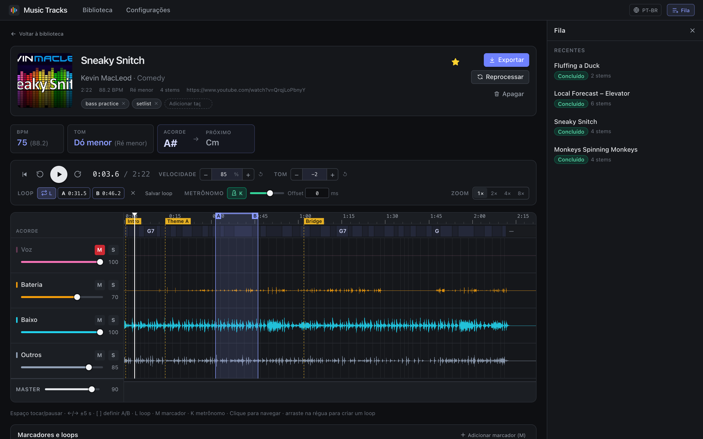
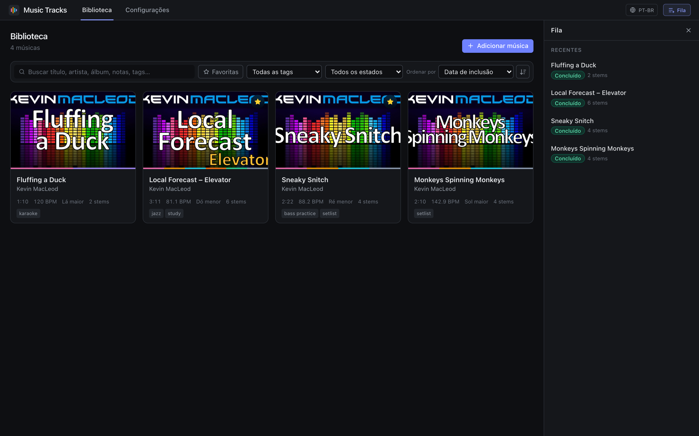

<div align="center">

# 🎚️ Music Tracks

**Separe qualquer música em faixas e pratique com elas — no seu computador, com privacidade e de graça.**

Separe voz, bateria, baixo, guitarra e piano com IA de ponta. Depois desacelere a música sem mudar o tom, transponha, repita o trecho difícil, tire o seu instrumento e toque junto com um metrônomo que acompanha a batida.

[](https://github.com/edumelocarv/music-tracks/actions/workflows/ci.yml)
[](LICENSE)


[English](README.md) · **Português (Brasil)**



</div>

---

## Por quê?

Praticar com gravações é o jeito mais rápido de aprender uma música. Mas quase sempre você quer *ouvir só o baixo*, *tirar a voz para cantar* ou *tocar o solo a 70% da velocidade*. Os separadores online sobem sua música para a nuvem, têm fila e paywall, e entregam um arquivo, não uma ferramenta de estudo.

**O Music Tracks roda inteiro no seu computador.** Você adiciona as músicas, ele separa as faixas na sua GPU, e você ganha um player feito para praticar, no navegador.

## Recursos

**🎛️ Separação de faixas**
- **2, 4 ou 6 faixas por música**: voz/instrumental · voz/bateria/baixo/outros · + guitarra e piano.
- Usa o **[Demucs](https://github.com/adefossez/demucs)** (`htdemucs_ft` e `htdemucs_6s`), um dos melhores modelos open source de separação.
- Roda em **GPUs Apple Silicon (MPS)**, **GPUs NVIDIA (CUDA)** ou na CPU, escolhidas automaticamente.

**🎧 Player para praticar**
- **Volume, mute e solo** por faixa, além de volume geral.
- **Velocidade de 50 a 150% sem mudar o tom** e **transposição de ±12 semitons sem mudar a velocidade**, em tempo real e com as faixas sempre sincronizadas ([Signalsmith Stretch](https://signalsmith-audio.co.uk/code/stretch/)).
- **Loop A-B**, loops salvos e **marcadores**.
- **Metrônomo** travado nas batidas detectadas, com acento no tempo forte, que acompanha a velocidade escolhida.
- **Waveforms** por faixa com zoom e uma **faixa de acordes** mostrando o acorde atual e o próximo.

**🎼 Análise**
- **BPM**, batidas e tempos fortes ([beat_this](https://github.com/CPJKU/beat_this)).
- **Tonalidade** e **acordes** (maiores, menores, com sétima), **transpostos automaticamente** quando você muda o tom.

**📚 Biblioteca**
- Adicione músicas por **upload**, **URL** (YouTube e [muitos outros sites](https://github.com/yt-dlp/yt-dlp/blob/master/supportedsites.md)) ou **pasta monitorada**.
- **Fila** de processamento com progresso ao vivo, cancelar e tentar de novo.
- Busca, ordenação, **tags**, **favoritas**, **notas**, metadados e capa editáveis.

**📦 Exportação**
- Faixas individuais, **ZIP com todas as faixas** ou **mix customizado** (seus volumes e mutes atuais, opcionalmente com velocidade e tom aplicados) em **WAV, FLAC ou MP3**.

**🌍 Interface em português (Brasil) e inglês.**



## Começando

Você precisa do **[uv](https://docs.astral.sh/uv/)** (instala o Python sozinho), do **[Node.js](https://nodejs.org/) 20+** (compila a interface na primeira execução) e do **[FFmpeg](https://ffmpeg.org/)**.

### macOS (Apple Silicon)

```sh
brew install uv node ffmpeg
git clone https://github.com/edumelocarv/music-tracks.git
cd music-tracks
./start.sh
```

### Windows 10/11

```powershell
winget install astral-sh.uv OpenJS.NodeJS.LTS Gyan.FFmpeg
# abra um terminal NOVO para atualizar o PATH e depois:
git clone https://github.com/edumelocarv/music-tracks.git
cd music-tracks
start.cmd
```

> Prefere PowerShell? Use `.\start.ps1` (se scripts estiverem bloqueados: `powershell -ExecutionPolicy Bypass -File .\start.ps1`).

### Linux (Debian/Ubuntu)

```sh
sudo apt install ffmpeg nodejs npm          # o Node.js precisa ser 20+ (use NodeSource ou nvm se a distro for antiga)
curl -LsSf https://astral.sh/uv/install.sh | sh
git clone https://github.com/edumelocarv/music-tracks.git
cd music-tracks
./start.sh
```

Fedora: `sudo dnf install ffmpeg nodejs uv` (FFmpeg do RPM Fusion). Arch: `sudo pacman -S ffmpeg nodejs npm uv`.

### Docker

```sh
docker compose up -d --build
```

Depois abra **http://127.0.0.1:8765**. Para usar GPU NVIDIA no Linux, instale o [NVIDIA Container Toolkit](https://docs.nvidia.com/datacenter/cloud-native/container-toolkit/) e descomente a seção `deploy:` do [`docker-compose.yml`](docker-compose.yml). No macOS o Docker não acessa a GPU da Apple, então no Mac a instalação nativa é bem mais rápida.

---

A primeira execução instala as dependências e compila a interface (alguns minutos), depois abre **http://127.0.0.1:8765** no navegador. Para parar, use **Ctrl+C**.

A **primeira separação baixa os modelos de IA** (~320 MB por modelo, uma vez só). Depois disso tudo funciona offline, exceto adicionar músicas por URL.

## Qual GPU vai ser usada?

| Seu computador | Instalação nativa | Docker |
|---|---|---|
| Mac com Apple Silicon (M1–M4) | ✅ GPU Apple (MPS) | só CPU |
| Windows + GPU NVIDIA | ✅ CUDA | ✅ CUDA (WSL 2) |
| Linux + GPU NVIDIA | ✅ CUDA | ✅ CUDA (Container Toolkit) |
| GPU AMD / Intel, ou sem GPU | CPU | CPU |

O dispositivo em uso aparece em **Configurações → Sistema**. A CPU funciona em qualquer máquina, só que é mais lenta: alguns minutos por música em vez de cerca de um. O suporte a NVIDIA usa o PyTorch com CUDA 12.6, que funciona com drivers dos últimos anos.

**Tempo típico de separação** de uma música de 4 minutos num Apple M4: cerca de **1 minuto** nos modos de 2 ou 4 faixas e uns **30 segundos** no modo de 6, mais alguns segundos de análise.

## Como usar

### Adicionando músicas

- **Upload**: clique em **Adicionar música** e arraste os arquivos (MP3, WAV, FLAC, M4A, AAC, OGG, Opus, AIFF, WMA, ou vídeos MP4/MKV/WebM). Até 500 MB e 15 minutos por música.
- **URL**: cole um link do YouTube ou de outro site suportado pelo yt-dlp. Playlists e lives não são aceitas.
- **Pasta monitorada**: jogue arquivos em `~/MusicTracks/inbox/` (Windows: `%USERPROFILE%\MusicTracks\inbox\`). Eles entram sozinhos, no modo de faixas padrão. Arquivos recusados vão para `inbox/_ignorados/` com um `.erro.txt` explicando o motivo.

Cada música passa pela fila (download → preparação → separação → análise → waveforms). Dá para continuar usando o app enquanto isso.

### Modos de separação

| Modo | Faixas | Modelo | Observações |
|---|---|---|---|
| **2** | voz, instrumental | `htdemucs_ft` | Karaokê e acapella |
| **4** | voz, bateria, baixo, outros | `htdemucs_ft` | Melhor qualidade, **o padrão** |
| **6** | voz, bateria, baixo, guitarra, piano, outros | `htdemucs_6s` | Guitarra razoável; **piano fraco** (costuma vazar para "outros") |

Você pode **reprocessar** uma música em outro modo quando quiser. As faixas atuais continuam tocáveis até as novas ficarem prontas.

### Atalhos de teclado

| Tecla | Ação |
|---|---|
| `Espaço` | Tocar / pausar |
| `←` / `→` | Voltar / avançar 5 s |
| `[` / `]` | Marcar início (A) / fim (B) do loop na posição atual |
| `L` | Ligar / desligar o loop A-B |
| `M` | Adicionar marcador |
| `K` | Ligar / desligar o metrônomo |

Também dá para clicar na waveform para navegar e **arrastar na régua** para criar um loop. Mixer, velocidade, tom, loop e metrônomo ficam salvos por música.

### Exportando

Clique em **Exportar** numa música para baixar uma faixa, um ZIP com todas, ou um **mix customizado** do que você está ouvindo agora (por exemplo, um playback sem o seu instrumento). No mix dá para aplicar a velocidade e o tom atuais, ou exportar só o trecho A-B.

## Configuração

Tudo (banco da biblioteca, áudio, modelos, logs) fica numa pasta de dados, **`~/MusicTracks`** por padrão. Dá para mudar em **Configurações** (vale depois de reiniciar; os dados existentes não são movidos) ou com variáveis de ambiente:

| Variável | Padrão | Para quê |
|---|---|---|
| `MUSIC_TRACKS_HOME` | `~/MusicTracks` | Pasta de dados (tem prioridade sobre as Configurações) |
| `MUSIC_TRACKS_PORT` | `8765` | Porta HTTP (ou `--port N`) |
| `MUSIC_TRACKS_NO_BROWSER` | — | `1` para não abrir o navegador (ou `--no-browser`) |
| `MUSIC_TRACKS_HOST` | `127.0.0.1` | Endereço de escuta (o Docker usa `0.0.0.0` dentro do container) |
| `MUSIC_TRACKS_ALLOWED_HOSTS` | — | Valores `host:porta` extras aceitos no cabeçalho `Host`, por exemplo quando o Docker mapeia outra porta |

Exemplo: `MUSIC_TRACKS_HOME=/Volumes/Externo/Musicas ./start.sh --port 9000`

> **Segurança:** o Music Tracks não tem login. Por padrão ele só escuta em `127.0.0.1` e recusa requisições cujo `Host`/`Origin` não seja o próprio app (proteção contra sites maliciosos e DNS rebinding). Não o exponha numa rede em que você não confia.

## Problemas comuns

<details>
<summary><b>Adicionar por URL do YouTube parou de funcionar</b></summary>

O YouTube muda com frequência, e o yt-dlp é atualizado para acompanhar. Atualize com:

```sh
cd backend
uv lock --upgrade-package yt-dlp --upgrade-package yt-dlp-ejs
uv sync
```
</details>

<details>
<summary><b>"A porta 8765 já está em uso"</b></summary>

Provavelmente outra cópia está rodando. Pare essa cópia ou use outra porta: `./start.sh --port 9000`.
</details>

<details>
<summary><b>"ffmpeg não encontrado" / "uv não encontrado"</b></summary>

Instale como mostrado em [Começando](#começando) e **abra um terminal novo** para atualizar o `PATH`. O launcher mostra o comando exato de instalação para o seu sistema.
</details>

<details>
<summary><b>A separação falha por falta de memória</b></summary>

O Music Tracks tenta de novo na CPU automaticamente. Músicas longas no modo de 6 faixas são as que mais usam memória. Feche outros programas pesados ou use o modo de 4 faixas. No navegador, uma música de 15 minutos com 6 faixas precisa de uns 2 GB de RAM.
</details>

<details>
<summary><b>Qual navegador usar?</b></summary>

Qualquer versão atual do **Chrome, Edge, Firefox ou Safari**. Reprodução, velocidade, mute e metrônomo foram verificados no Chromium, no Firefox e no WebKit (o motor do Safari). O Chrome é o mais usado no dia a dia, então avise se algo estranho acontecer nos outros.
</details>

Os logs ficam em `~/MusicTracks/logs/` (`api.log`, `worker.log`).

## Como funciona

```
Navegador (React + Web Audio)  ──HTTP──▶  API (FastAPI, 127.0.0.1)  ──SQLite──▶  Worker
  • um único nó Signalsmith Stretch           • biblioteca, uploads, exportações  • fila (um job por vez)
    para todas as faixas → sempre em sincronia • serve a interface                 • yt-dlp → FFmpeg → Demucs
  • ganho por faixa, metrônomo                                                     • beat_this, librosa (tom, acordes)
```

- O **worker** roda separado da API. Assim a separação pesada nunca trava a interface, e um crash não corrompe a biblioteca: os resultados são trocados de forma atômica, e jobs interrompidos são recuperados ao reiniciar.
- No navegador, **todas as faixas passam por um único nó de time-stretch**. Elas nunca saem de sincronia, e mute/solo são instantâneos.

A especificação completa do projeto está em [`docs/spec.md`](docs/spec.md), e a API HTTP está documentada em [`docs/api-contract.md`](docs/api-contract.md).

## Desenvolvimento

```sh
./dev.sh                      # worker + API com auto-reload + Vite em http://localhost:5173
                              # (Windows: start.cmd --dev)
cd backend && uv run pytest   # testes do backend (rápidos, offline)
uv run pytest -m slow         # testes que usam os modelos reais
cd frontend && npm test       # testes do frontend
```

| Caminho | O que tem lá |
|---|---|
| `backend/app/api/` | Rotas FastAPI, middleware de segurança |
| `backend/app/worker/` | Fila, pipeline, separação com Demucs, downloads, pasta monitorada |
| `backend/app/analysis/` | Batidas/BPM, tonalidade, acordes, picos das waveforms |
| `backend/app/launcher.py` | Launcher multiplataforma usado por `start.sh` / `start.cmd` / `start.ps1` |
| `frontend/src/audio/` | Motor de áudio em tempo real, cálculos de tempo, regras do loop A-B |
| `frontend/src/player/` | Player, mixer, waveforms, marcadores |

O CI roda os testes do backend em **Linux, Windows e macOS**, e os testes e o build do frontend, a cada push.

## Contribuindo

Contribuições são muito bem-vindas. Veja o [CONTRIBUTING.md](CONTRIBUTING.md). Algumas ideias:

- Suporte a **GPU AMD (ROCm)** no Linux
- Modelos **Roformer** opcionais, para voz ainda mais limpa e guitarra/piano melhores
- Reconhecimento de acordes melhor, exibição de letras, mais idiomas na interface
- Testes e feedback em máquinas Windows e Linux

## Uso responsável

O Music Tracks é uma ferramenta para **estudo e prática pessoal**. Só baixe e processe áudio que você tem direito de usar, e respeite os direitos autorais e os termos de uso dos sites que você usa.

## Créditos

Feito sobre ótimos projetos open source:
[Demucs](https://github.com/adefossez/demucs) (MIT) ·
[beat_this](https://github.com/CPJKU/beat_this) (MIT) ·
[librosa](https://librosa.org) (ISC) ·
[Signalsmith Stretch](https://github.com/Signalsmith-Audio/signalsmith-stretch) (MIT) ·
[python-stretch](https://github.com/gregogiudici/python-stretch) (MIT) ·
[yt-dlp](https://github.com/yt-dlp/yt-dlp) (Unlicense) ·
[PyTorch](https://pytorch.org) · [FastAPI](https://fastapi.tiangolo.com) · [React](https://react.dev) · [FFmpeg](https://ffmpeg.org).

Músicas nas imagens: *Sneaky Snitch*, *Local Forecast – Elevator*, *Monkeys Spinning Monkeys* e *Fluffing a Duck*, de **Kevin MacLeod** ([incompetech.com](https://incompetech.com)), sob a licença [Creative Commons: By Attribution 4.0](https://creativecommons.org/licenses/by/4.0/).

## Licença

[MIT](LICENSE)
